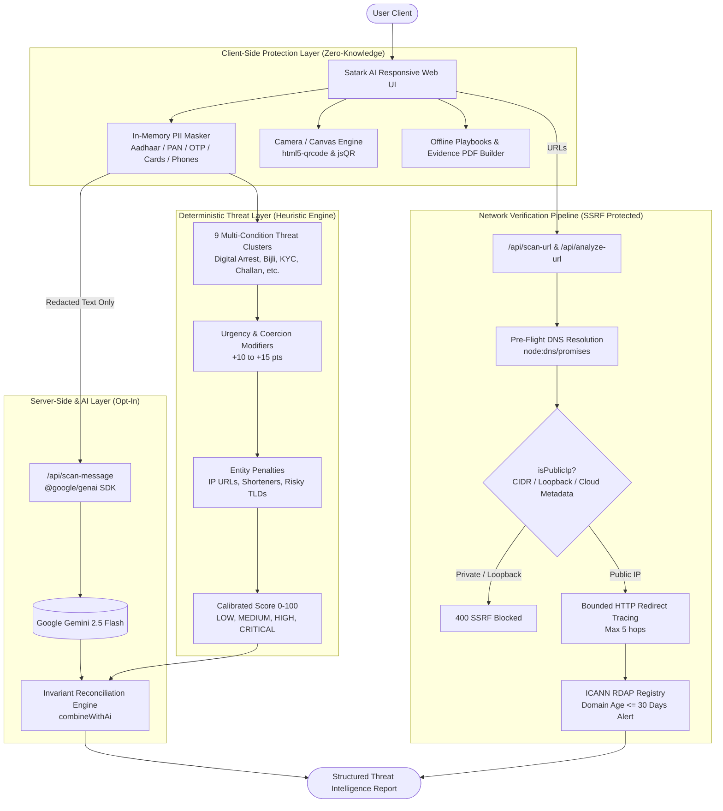
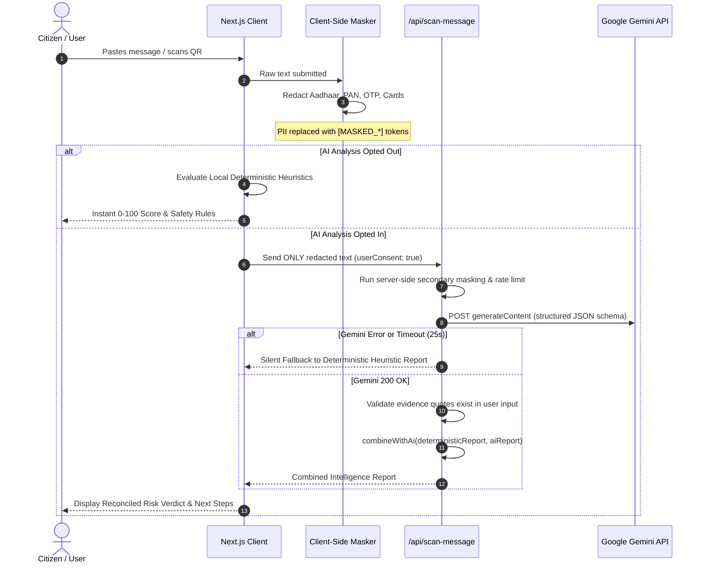

# Satark AI — Technical Design Document (TDD)
**Platform:** Next.js 14 Enterprise Cybersecurity & Scam Intelligence  
**Focus:** Privacy-First In-Memory Redaction, Multi-Vector Threat Clusters & SSRF-Safe Auditing  

---

## 1. System Architecture Overview

Satark AI combines client-side zero-knowledge privacy defenses, deterministic threat heuristics, and opt-in large language model contextual reasoning.



---

## 2. Core Subsystems

### 2.1 Zero-Knowledge Client-Side Redaction (`src/lib/scanner/masking.ts`)
* **Aadhaar Numbers:** Matches 12-digit numbers with unformatted digits or variable whitespace/hyphens (`\b\d{4}[\s-]*\d{4}[\s-]*\d{4}\b`).
* **PAN Cards:** Case-insensitive 10-character alphanumeric pattern (`\b[A-Za-z]{5}[\s-]?[0-9]{4}[\s-]?[A-Za-z]{1}\b`).
* **OTP / Secret Codes:** Redacts 4-to-6 digit verification numbers in label-first (`OTP is 492019`) and label-last (`492019 is your OTP`) syntax.
* **Payment Credentials:** Strips 16-digit card numbers, 3-to-4 digit CVVs, and long bank account numbers.

### 2.2 Deterministic Multi-Layered Heuristic Engine (`src/utils/heuristics.ts`)
Scoring is calculated across three additive dimensions:
1. **Threat Cluster Base Score (Highest Matched Cluster):**
   * `BANKING_REWARDS` (Score: 85): Bank entity + reward/expiry points + claim action.
   * `KYC_SUSPENSION` (Score: 90): Identity document + block/freeze threat + update/click demand.
   * `UTILITY_DISCONNECT` (Score: 95): Power board + disconnection threat + deadline/officer contact.
   * `WFH_TASK_SCAM` (Score: 95): WFH/part-time + like/review task + Telegram/HR routing.
   * `CUSTOMS_PARCEL` (Score: 90): Courier/India Post + seized/held status + fee/update link.
   * `LOTTERY_GIFT` (Score: 95): Brand/KBC lure + crore/iPhone prize + winner/tax claim.
   * `DIGITAL_ARREST_AUTHORITY` (Score: 100): Law enforcement/CBI/Police + arrest/FIR/narcotics/Skype demand.
   * `FAKE_CHALLAN` (Score: 85): E-challan + pending fine (excluding official `echallan.parivahan.gov.in`).
   * `MALICIOUS_PAYLOAD` (Score: 100): Download/install demand + `.apk` sideloading or AnyDesk/TeamViewer.
2. **Behavioral & Urgency Modifiers:**
   * Extreme Urgency: +10 pts
   * Action Coercion: +10 pts
   * Financial Pressure: +15 pts
3. **Entity Penalties:**
   * Raw IP Address URL: +25 pts
   * URL Shorteners (bit.ly, tinyurl, etc.): +20 pts
   * High-Risk TLDs (`.xyz`, `.top`, `.live`, `.cc`, etc.): +20 pts
   * Free Forms/Hosting with financial requests: +15 pts

$$\text{Final Score} = \min(100, \text{BaseScore} + \sum \text{Modifiers} + \sum \text{EntityPenalties})$$

### 2.3 Hybrid AI Reconciliation Safety Invariants (`src/lib/scanner/engine.ts`)
* **Invariant Rule:** Deterministic heuristic findings represent an uncompromising security floor.
* If deterministic rules flag `HIGH_RISK` and Gemini returns `no_strong_warning` or `suspicious`, the final verdict **remains `HIGH_RISK`** with an explicit disagreement disclosure.
* If Gemini detects high-risk context missed by keyword patterns, the verdict elevates to at least `SUSPICIOUS`, adjusting the score to prevent contradictory `0/100` scores.

### 2.4 SSRF-Safe Network Audit Pipeline (`src/lib/url/*`)
```
User URL Input ──> URL Normalization (scheme, no fragments, port limits)
                         │
                         ▼
               Pre-Flight DNS Resolution
                         │
        ┌────────────────┴────────────────┐
        ▼                                 ▼
   Non-Public IP / Loopback           Globally Routable Public IP
   (127.0.0.1, 10.0.0.0/8, CIDR)                 │
        │                                        ▼
   400 Bad Request                 HTTP Request with Pinned IP
   "SSRF Prohibited"               (Max 5 redirects, hop timeout 6s)
                                                 │
                                                 ▼
                                   ICANN Public RDAP Audit
                                   (Flag if age <= 30 days)
```

---

## 3. Data Flow & Security Sequence



---

## 4. API Endpoints

| Endpoint | Method | Input | Description |
|---|---|---|---|
| `/api/scan-message` | `POST` | `{ text: string, userConsent: boolean }` | Hybrid message inspection via `@google/genai` with deterministic fallback. |
| `/api/scan-url` | `POST` | `{ url: string }` | SSRF-safe URL resolution, bounded redirect trace, and RDAP domain age check. |
| `/api/analyze-url` | `POST` | `{ url: string }` | Core URL auditing pipeline with Safe Browsing / URLhaus integration. |
| `/api/evidence-pdf`| `POST` | `{ incidentDetails, reportData }` | Generates a shareable, client-redacted forensic PDF report. |
